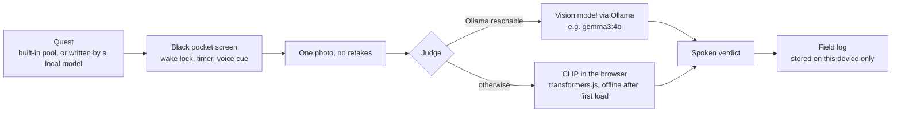

# Tuft

**A quest that ends outside.** Tuft hands you a small nature quest, turns your screen black, and tells you to put the phone in your pocket. When time is up you take one photo, and an open-weight vision model on your own device decides if you did it.

Built for the Hacktoberfest 2026 Open-Source AI Challenge, Week 1: Touch Grass.

- App: `/` (single page, no build step, no backend)
- Benchmark: `/bench/` (measure the judge on your own photos)

## How it works



- **Pocket screen:** pure black (off pixels on OLED), screen wake lock so the timer survives, a buzz and a spoken cue at the end. Double-tap ends early.
- **Judge, in order:** a vision model through Ollama if one is reachable, else CLIP (`Xenova/clip-vit-base-patch32`) running in the browser. CLIP scores the photo against the quest description and a set of "not this" labels.
- **Privacy:** photos are resized and judged on your device. The only network calls are the first download of the page assets and model weights, and your own Ollama address if you set one. The field log lives in `localStorage`.
- **Swap the model:** type any Ollama vision model name in Model settings. Nothing else changes.

## Run it

Service workers need `localhost` or HTTPS, so do not open the file directly.

```bash
git clone https://github.com/Divyansh0208/Tuft && cd Tuft
python3 -m http.server 8080
# open http://localhost:8080
```

Optional vision model on your machine:

```bash
ollama pull gemma3:4b
OLLAMA_ORIGINS=* ollama serve
```

Then reload Tuft. The top line shows which judge is active. From the hosted site your browser may block or prompt for access to `localhost`; the local server above is the reliable path.

## Offline

After one online visit where the judge has answered once, the page, the CLIP library and its model weights are cached. The service worker (`sw.js`) caches the app shell and the CDN files it loads. Model weights are cached by transformers.js in the browser cache.

Status: **[ ] verified in airplane mode on my phone** (tick this only after testing).

## Benchmark

Open `/bench/`, add photos, tag each with its quest and whether it truly completes it, then run CLIP and optionally an Ollama model. It reports accuracy with 95% intervals, picks a threshold on one half of your photos and tests it on the other half, adds a "can't tell" band, runs an exact paired test, and lists every miss. Download the raw data for this repo.

Results from my campus photos:

| Judge | Correct | Real completions caught | False passes |
|---|---|---|---|
| CLIP, default rule | [fill after bench] | | |
| CLIP, calibrated threshold (held-out half) | [fill after bench] | | |
| Gemma via Ollama | [fill after bench] | | |

Small samples give wide intervals, and these photos are mine, from one place and one week.

## Limits (honest list)

- CLIP matches photos to descriptions. It does not know species, and it can be fooled by a photo that looks like the quest.
- The first judged photo needs a connection and about 150 MB of storage.
- The built-in quest pool has 10 quests. A local model can write more, but quality varies by model.
- Browsers can evict cached data under storage pressure. The app asks for persistent storage, and the browser may say no.
- Not tested on every phone. Wake lock and speech support differ between browsers.

## Files

```
index.html             the app
sw.js                  service worker (offline shell + CDN cache)
manifest.webmanifest   install to home screen
icon-192.png, icon-512.png
bench/index.html       benchmark page
docs/                  screenshots
LICENSE                MIT
```

## Deploy

Any static host. On Render: New, Static Site, this repo, branch `main`, build command blank, publish directory `.`.

## Credits

CLIP via [transformers.js](https://github.com/huggingface/transformers.js) (Xenova port of OpenAI CLIP, MIT). Optional vision models through [Ollama](https://ollama.com). Type is Bricolage Grotesque. Built with an AI coding assistant in a pair-programming session; I set the idea, ran the tests outside, and reviewed every change.
